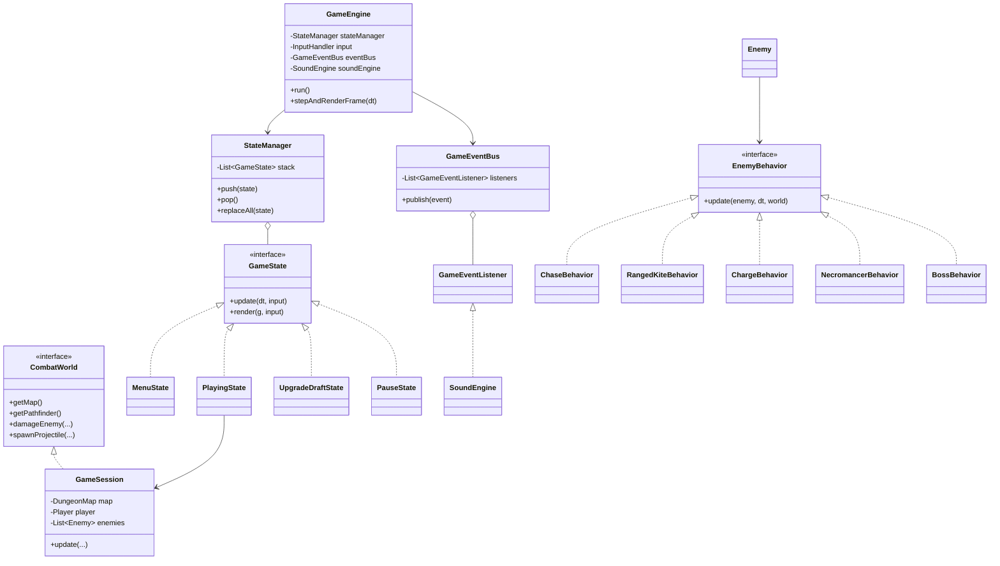

# CHRONOS: Aethelgard's Descent

Ein vollständiger, prozeduraler **Action-Roguelite Dungeon Crawler** in reinem Java (Java 21+ / Java2D / Swing / Java Sound API) – entwickelt ohne externe Bibliotheken für ein Informatik-Abschlussprojekt.


> **Entwickelt durch:** K Mujkanovic  
> **Veröffentlicht durch:** c1llsh0t


## ▶ Im Browser spielen

**https://c1llsh0t.github.io/chronos-descent/**

Die Web-Version läuft direkt im Browser – ohne Java, ohne Installation (Tastatur & Maus empfohlen).
Sie ist eine vollständige JavaScript/HTML5-Canvas-Portierung im Ordner [`docs/`](docs/) und nutzt einen
exakten Nachbau von `java.util.Random`: **Gleicher Seed = gleicher Dungeon** wie in der Java-Desktop-Version.
Bestenliste, Erfolge und Einstellungen werden im Browser (localStorage) gespeichert.

---

## Inhaltsverzeichnis
1. [Projektüberblick & Spielprinzip](#projektüberblick--spielprinzip)
2. [Kompilierung & Ausführung](#kompilierung--ausführung)
3. [Steuerung](#steuerung)
4. [Heldenklassen, Gegner & Roguelite-Systeme](#heldenklassen-gegner--roguelite-systeme)
5. [Software-Architektur & Entwurfsmuster](#software-architektur--entwurfsmuster)
6. [Eingesetzte Informatik-Algorithmen](#eingesetzte-informatik-algorithmen)
7. [Paketstruktur](#paketstruktur)
8. [Automatisierte Tests](#automatisierte-tests)

---

## Projektüberblick & Spielprinzip

In **CHRONOS: Aethelgard's Descent** erkundet der Spieler drei prozedural generierte Dungeon-Ebenen, kämpft in Echtzeit gegen unterschiedliche Gegnertypen mit eigenem KI-Verhalten, sammelt Erfahrungspunkte für **Roguelite-Upgrades** (16 stapelbare Relikte in 4 Seltenheitsstufen) und stellt sich auf Ebene 3 dem zweiphasigen Endboss **Malakor, der Chronos-Wächter**.

### Besondere Merkmale für die Projektbewertung
- **Null externe Abhängigkeiten:** Reines JDK (Standardbibliothek `javax.swing`, `java.awt`, `javax.sound.sampled`, `java.nio.file`). Läuft auf jedem Rechner mit Java 21+.
- **Deterministische Seeds:** Jeder Dungeon-Run lässt sich über einen beliebigen Text- oder Zahlen-Seed exakt reproduzieren (ideal für Präsentationen & Fehlersuche).
- **Zweisprachig (DE / EN):** Laufzeitumschaltung der gesamten Benutzeroberfläche per Taste `[L]` oder Button.
- **Prozedurale Audio-Synthese:** Alle 15 Soundeffekte werden beim Start mathematisch als PCM-Wellenformen (Sinus, Rechteck, Dreieck, Rauschen) synthetisiert – ganz ohne externe `.wav`/`.mp3`-Dateien.
- **Persistente Speicherung:** Bestenliste (Top 10 Runs), freigeschaltete Erfolge (8 Achievements) und Einstellungen werden unter `~/.chronos-descent/save.dat` gesichert.

---

## Kompilierung & Ausführung

### Option A: Per Start-Skript (Windows)
- **Spiel bauen & starten:** Doppelklick oder Terminal-Aufruf von `build_and_run.bat` (bzw. `build_and_run.ps1`)
- **Tests ausführen:** `run_tests.bat`

### Option B: Manuell im Terminal
```bash
# Kompilieren
mkdir out
javac --release 21 -encoding UTF-8 -d out $(find src/main/java -name "*.java")

# Ausführen
java -cp out de.chronos.Main
```

*(Unter Windows PowerShell alternativ `build_and_run.ps1` nutzen.)*

---

## Steuerung

| Taste / Eingabe | Aktion |
| :--- | :--- |
| `W A S D` / Pfeiltasten | Bewegung |
| Maus bewegen | Zielen (Fadenkreuz) |
| Linksklick / `J` | Primärangriff (gedrückt halten für Dauerangriff) |
| `Leertaste` / `Shift` | Dash (mit Unverwundbarkeits-Frames & Klasseneffekt) |
| `Q` / Rechtsklick | Klassen-Fähigkeit 1 |
| `E` | Klassen-Ultimate |
| `F` | Interagieren (Schatztruhe, Heilschrein, Relikt-Altar, Portal) |
| `TAB` | Große Dungeon-Karte ein-/ausblenden |
| `ESC` / `P` | Pause-Menü |
| `M` | Prozeduralen Ton stummschalten / aktivieren |
| `L` | Sprache umschalten (Deutsch / Englisch) |
| `F11` | Vollbildmodus umschalten |

---

## Heldenklassen, Gegner & Roguelite-Systeme

### 3 Spielbare Heldenklassen
1. **Klingenwächter (Vanguard):** Nahkampf-Tank mit breitem Schwertbogen, blockendem Schild-Dash (zerstört gegnerische Geschosse), Wirbelnova (`[Q]`, Betäubung) und Unbezwingbarer Ägis (`[E]`, Schild + Unverwundbarkeit).
2. **Arkanmagier (Arcanist):** Fernkämpfer mit zielsuchenden Arkanbolzen, Teleport-Dash, Frostnova (`[Q]`, Verlangsamung) und Meteorsturm (`[E]`, 5 verzögerte Flächenexplosionen).
3. **Schattenjäger (Shadowblade):** Schneller Assassine mit Gift-Wurfdolchen, Explosions-Köder beim Dash, Klingenfächer (`[Q]`, 9 Dolche) und Schattenrausch (`[E]`, Cooldown-Reset + Rausch).

### 6 Gegnertypen + Boss-Phasen
- **Schleimling & Älterer Schleim:** Verfolgt den Spieler via A*; Ältere Schleime spalten sich beim Tod in zwei kleine Schleime.
- **Skelettschütze:** Hält optimale Kampfdistanz (Kiting), weicht seitlich aus und warnt vor jedem Schuss mit einer roten Ziellinie (Telegraphing).
- **Eisenbrecher (Berserker):** Telegraphiert einen schnellen Sturmangriff; weicht der Spieler aus und der Berserker prallt gegen eine Wand, betäubt er sich selbst (`STUN!`).
- **Nekromant:** Hält Abstand, beschwört Diener und feuert Schatten-Salven.
- **Malakor, der Chronos-Wächter (Ebene 3 Boss):** Zweiphasiger Boss mit rotierender Geschoss-Spirale und telegraphierten Boden-Slams; unter 50 % HP folgt Phase II mit schnellerer Doppelspirale, Dreifach-Slams und Beschwörung.

---

## Software-Architektur & Entwurfsmuster

Das Projekt trennt strikt Logik, Weltmodell, KI, Rendering und UI nach dem Schichten- und Komponentenprinzip:



### Verwendete Entwurfsmuster (Design Patterns)
| Muster | Umsetzung im Projekt | Zweck |
| :--- | :--- | :--- |
| **State Pattern** | `GameState`, `StateManager` | Stapelbare Spielzustände (`Menu`, `Playing`, `UpgradeDraft`, `Pause`, `RunEnd`, `Highscore`, `Help`). |
| **Strategy Pattern** | `EnemyBehavior` (`Chase`, `RangedKite`, `Charge`, `Necromancer`, `Boss`) | Austauschbares KI-Verhalten zur Laufzeit ohne riesige `if/else`-Blöcke. |
| **Observer Pattern** | `GameEventBus`, `GameEvent` (Sealed Record Hierarchy) | Entkoppelt Kampflogik vollständig von Sound-Effekten (`SoundEngine`). |
| **Dependency Inversion** | `CombatWorld`-Interface | Gegner-KI und Projektile greifen nur auf ein abstraktes Welt-Interface statt auf Swing/UI-Klassen zu. |
| **Factory / Pool** | `DungeonGenerator`, `UpgradePool` | Zentralisierte Erzeugung und gewichtete Zufallsauswahl von Ebenen und Relikten. |

---

## Eingesetzte Informatik-Algorithmen

1. **Binary Space Partitioning (BSP) + Prims Minimaler Spannbaum (MST)** (`DungeonGenerator.java`)
   - Teilt die Kartenfläche rekursiv in überlappungsfreie Rechtecke (Blattknoten des BSP-Baums) und platziert darin Räume.
   - Verbindet alle Raumzentren mit **Prims MST** minimal-zusammenhängend und ergänzt ~25 % kurze Kanten für taktische Rundwege.
2. **Doppel-BFS-Graphdurchmesser** (`DungeonGenerator.java`)
   - Zwei aufeinanderfolgende Breitensuchen (Breadth-First Search) bestimmen den exakten Graphdurchmesser des Raumgraphen. Start- und Bossraum liegen dadurch garantiert maximal weit auseinander.
3. **A\*-Pfadfindung mit Corner-Cutting-Schutz** (`AStarPathfinder.java`)
   - Verwendet `PriorityQueue` und Oktil-Heuristik für 8-Richtungs-Bewegung, verhindert das Schneiden von Wandecken und begrenzt die maximale Knotenexpansion (`MAX_EXPANDED_NODES = 1800`) für stabile 60 FPS.
4. **Recursive Shadowcasting (8 Oktanten) & Bresenham Line-of-Sight** (`DungeonMap.java`)
   - Berechnet in Echtzeit ein präzises Sichtfeld (`UNSEEN`, `EXPLORED`, `VISIBLE`) inklusive Lichtabfall und Sichtlinienprüfung für Fernkämpfer.
5. **Fixed-Timestep Game Loop & Achsengetrennte Kreis-Tile-Kollision** (`GameEngine.java`, `DungeonMap.java`)
   - Deterministische Physik-Updates mit `FIXED_DT = 1/60s` und separater X-/Y-Kollisionsauflösung für flüssiges Gleiten entlang von Wänden.

---

## Paketstruktur

```text
src/
├── main/java/de/chronos/
│   ├── Main.java                     # Einstiegspunkt & --smoke-test Flag
│   ├── audio/SoundEngine.java        # Prozeduraler PCM-Synthesizer
│   ├── combat/                       # StatusEffect, Upgrade, UpgradePool, Achievement, FloatingText
│   ├── core/                         # GameConfig, GameEngine, InputHandler, I18n, SaveManager
│   │   └── event/                    # GameEvent (sealed), GameEventBus, GameEventListener
│   ├── entity/                       # Entity, HeroClass, Player, Enemy, Projectile, Pickup, Props
│   │   └── ai/                       # EnemyBehavior + 5 KI-Strategien inkl. BossBehavior
│   ├── graphics/                     # Camera, Particle, ParticleSystem, WorldRenderer
│   ├── math/                         # Vector2D, SeededRandom
│   ├── ui/                           # GameFrame, HudRenderer
│   │   └── state/                    # StateManager, GameSession & alle 8 GameStates (inkl. IntroState)
│   └── world/                        # TileType, Room, DungeonMap, DungeonGenerator, AStarPathfinder
└── test/java/de/chronos/
    └── TestSuite.java                # Automatisierte Unit- & Integrationstests
```

---

## Automatisierte Tests

`run_tests.bat` kompiliert und prüft unter anderem:
- **150 prozedurale Maps** (50 Seeds × 3 Ebenen) per Tile-BFS auf 100 % Erreichbarkeit aller Räume & Determinismus
- **A\*-Pfadfindung** auf Gültigkeit und Verhalten bei unerreichbaren Zielen
- **Fog-of-War & Bresenham LoS**
- **Kampfsystem, Level-Up, Upgrades & Elder-Slime-Spaltung** (ohne `ConcurrentModificationException`)
- **Persistenz-Roundtrip** im `SaveManager`
- **Headless-Simulation & Java2D-Rendering** aller 3 Heldenklassen sowie des Ebene-3-Bosskampfes

---

## Download & Schnellstart

1. **Java 21 oder neuer** installieren (z.B. [Adoptium Temurin](https://adoptium.net)).
2. Unter *Releases* bzw. im Ordner `dist/` die Datei `chronos-descent.jar` herunterladen.
3. Doppelklick auf die JAR oder im Terminal: `java -jar chronos-descent.jar`

---

## Neu in der Web-Version: Statistik

Im Hauptmenü unter **Statistik** steht in Tabellen alles, was du über alle Runs hinweg gemacht und geschafft hast:
Runs, Siege, Niederlagen, Siegquote, Spielzeit, Erfolge · Rekorde (Punkte, Stufe, Ebene, Kombo, schnellster Sieg) ·
Kampfwerte (Kills, Schaden, Treffer, Angriffe, Krits, Dashes, Fähigkeiten) · Beute (Gold, Truhen, Schreine, Relikte, Tränke) ·
besiegte Gegner pro Typ · Werte pro Heldenklasse und pro Schwierigkeitsgrad. Gespeichert wird im Browser.

## Änderungen in Version 1.3.0 – brutal

| | Leben | Tempo | Schaden | Angriffstempo | Zusatzgegner/Raum | Punkte |
| :--- | :---: | :---: | :---: | :---: | :---: | :---: |
| Normal | ×1.9 | ×1.18 | ×2.3 | ×1.55 | +3 | ×1.0 |
| Schwer | ×2.5 | ×1.32 | ×3.0 | ×1.8 | +4 | ×1.8 |
| Alptraum | ×3.3 | ×1.48 | ×4.0 | ×2.1 | +5 | ×2.8 |

- Pro Ebene +65 % Gegner-Leben und +40 % Gegner-Schaden
- Malakor: 1400 Grund-Leben
- Unverwundbarkeit nach Treffer 0,25 s, **keine Heilung mehr beim Stufenaufstieg**, Schild-Regeneration 1,5/s, Heiltrank-Chance 5 %, Stachelfallen 25 Schaden

## Änderungen in Version 1.2.0 – noch schwerer

| | Leben | Tempo | Schaden | Angriffstempo | Zusatzgegner/Raum | Punkte |
| :--- | :---: | :---: | :---: | :---: | :---: | :---: |
| Normal | ×1.5 | ×1.12 | ×1.8 | ×1.35 | +2 | ×1.0 |
| Schwer | ×2.0 | ×1.25 | ×2.4 | ×1.6 | +3 | ×1.6 |
| Alptraum | ×2.7 | ×1.4 | ×3.2 | ×1.9 | +4 | ×2.5 |

- Pro Ebene +55 % Gegner-Leben und +30 % Gegner-Schaden
- Malakor: 1100 Grund-Leben
- Unverwundbarkeit nach Treffer 0,30 s, Heilung beim Stufenaufstieg 5 HP, Schild-Regeneration 2/s, Heiltrank-Chance 7 %, Stachelfallen 20 Schaden

## Änderungen in Version 1.1.0 – deutlich schwerer

- **Gegner sind gefährlicher:** Die Schwierigkeit erhöht jetzt auch Gegner-Schaden, Angriffstempo und die Anzahl Gegner pro Raum (vorher nur Leben & Tempo)

| | Leben | Tempo | Schaden | Angriffstempo | Zusatzgegner/Raum | Punkte |
| :--- | :---: | :---: | :---: | :---: | :---: | :---: |
| Normal | ×1.25 | ×1.08 | ×1.4 | ×1.2 | +1 | ×1.0 |
| Schwer | ×1.7 | ×1.2 | ×1.9 | ×1.4 | +2 | ×1.5 |
| Alptraum | ×2.2 | ×1.32 | ×2.5 | ×1.65 | +3 | ×2.2 |

- **Tiefere Ebenen:** +45 % Gegner-Leben und +20 % Gegner-Schaden pro Ebene
- **Malakor** hat 850 statt 520 Grund-Leben
- **Spieler:** Kürzere Unverwundbarkeit nach Treffern, weniger Heilung beim Stufenaufstieg, langsamere Schild-Regeneration, seltenere Heiltränke, Stachelfallen schmerzhafter

## Änderungen in Version 1.0.1

- **Web-Version** (`docs/`) – spielbar im Browser über GitHub Pages

- **Intro-Bildschirm** beim Start mit Credits (überspringbar per Taste/Klick)
- **Start unter Windows repariert:** Start-Skripte mit Windows-Zeilenenden & Fehlermeldungen, Build für Java 21+, kein erzwungenes OpenGL mehr
- **Bugfixes:**
  - Siegbonus wurde doppelt mit dem Schwierigkeitsfaktor multipliziert
  - *Arkane Detonation* löste bei Projektilen zwei Explosionen statt einer aus
  - *Schattenrausch* (Frenzy) erhöhte das Tempo doppelt
  - Ton konnte bei vielen gleichzeitigen Effekten dauerhaft verstummen bzw. verspätet abgespielt werden
  - Gegner ohne gefundenen Weg starteten jeden Frame eine neue A*-Suche (Ruckler)
  - Objekte, die in einer Wand landeten, blieben für immer stecken
  - Gift-/Brandschaden zeigte doppelte Schadenszahlen
  - Heilschrein & Relikt-Altar geben jetzt Rückmeldung, wenn das Gold nicht reicht
  - Klassenbeschreibungen an die tatsächlichen Fähigkeiten angepasst
